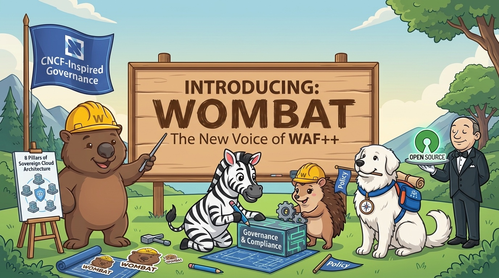
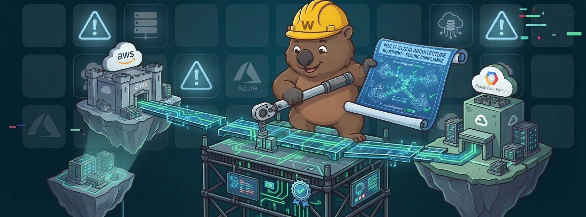
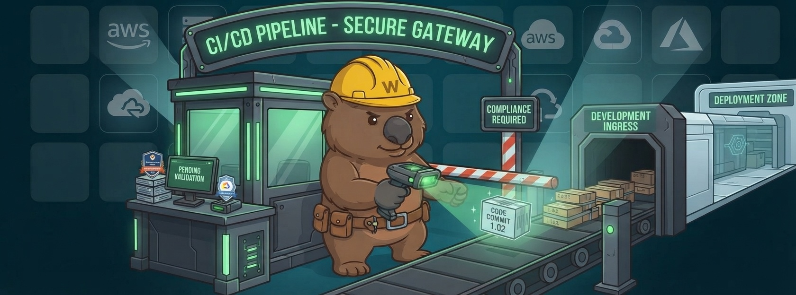
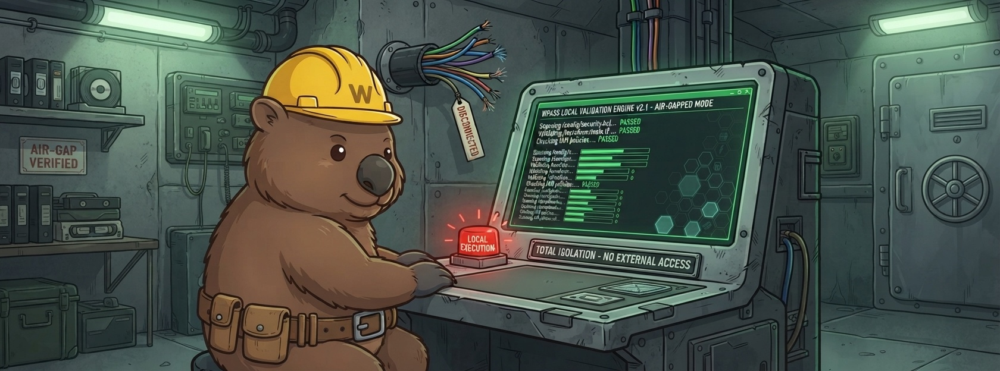
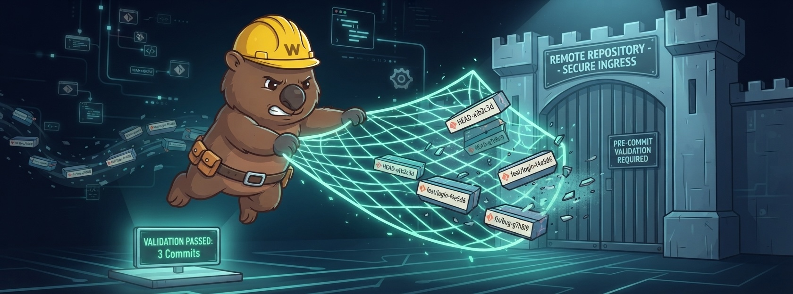
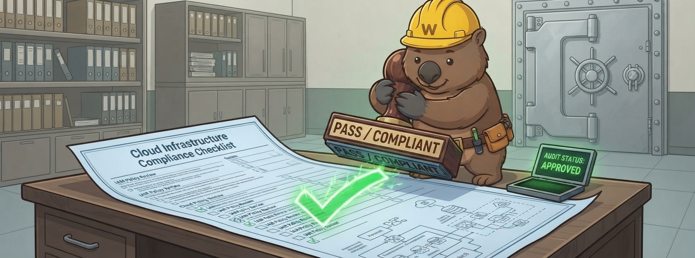
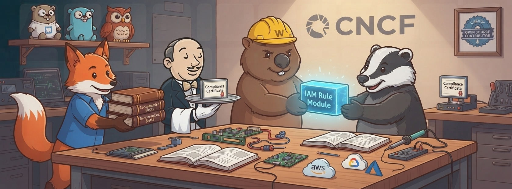

Am 28. Oktober 2026 wurde aus dem Projekt, das als WAF++ gestartet ist, Wombat.

Das ist kein Pivot. Nichts wurde übernommen, nichts abgespalten, kein Strategiedeck war beteiligt. Die Controls, der Code, die Lizenzen, das Governance-Modell und die Menschen — es sind dieselben, die elf Monate zuvor in einer Hotelbar über Cloud-Architektur diskutiert haben.

Geändert hat sich das, was die Community hundertmal am Tag laut sagen muss: der Name.

## Wo das angefangen hat

Es war der Abend vor der Cloud Native Conference 2025. Tim, Sebastian und ich saßen in einer Hotelbar mit zu wenig Steckdosen und zu viel Gesprächsstoff — Cloud-Architektur, Souveränität, Provider-Lock-in und die unangenehme Erkenntnis, dass die „Best Practices", an die wir uns alle halten sollten, meistens eine Produkt-Roadmap mit einem Diagramm obendrauf waren.

Die Lücke war offensichtlich: Jeder Hyperscaler hat ein Well-Architected Framework. Keines davon ist neutral. Keines gehört den Menschen, die die Architekturen tatsächlich bauen. Ein offenes, engineering-getriebenes, von der Community getragenes Gegenstück gab es nicht.

Zwei Wochen später kam Artem dazu — und passenderweise war er es auch, der den ersten Namen gefunden hat.

Unsere Open-Source-Idee war nie „ein PDF veröffentlichen und hoffen, dass es zitiert wird". Sondern: Die Kriterien selbst müssen öffentlich, zitierbar, forkbar und diskutierbar sein. Jeder Control soll etwas sein, auf das man im Audit zeigen kann, dem man in einem Pull Request widersprechen kann — und das man öffentlich verbessern kann.

## Was wir tatsächlich gebaut haben

Zwischen dieser Bar und diesem Beitrag ist eine Menge passiert:

- **Februar 2026** — Marketing-Website und Antora-Dokumentation gehen live.
- **12. Mai 2026** — Version 1.0 des Frameworks und der Tooling-Suite erscheint, einen Tag vor der Cloud Native Conference 2026 in Frankfurt.
- **Juli 2026** — die Agentic-Säule kommt dazu; das Framework hat jetzt acht Säulen.
- **Heute** — Framework v1.1, WOMBATpass v1.1.0, mehr als 100 Controls, das PASS-Scoring-Modell und Governance über öffentliche RFCs.

Das Tooling ist mitgewachsen. WOMBATpass ist CLI, Dashboard und Server, dazu eine GitHub Action und ein MCP-Server. Es parst Terraform und AWS CDK statisch, bewertet die Controls und erzeugt auditfähige Evidenz — ohne Cloud-Zugangsdaten.

<figure class="article-fig">
  
  <figcaption>Ein Blueprint über isolierte Provider-Umgebungen hinweg — das ist die Idee in einem Bild. Der Blueprint ist öffentlich, und jeder kann ihn ändern.</figcaption>
</figure>

## Der Teil von Open Source, den wir falsch hatten

Jetzt kommt der unangenehme Teil: Unsere Lizenzen waren von Tag eins offen. Apache 2.0 für den Code, CC BY 4.0 für die Dokumentation. Auch die Governance war offen — jede wesentliche Entscheidung läuft durch ein öffentliches RFC, mit Begründung.

Und trotzdem war etwas kaputt.

Denn Offenheit ist nicht nur eine `LICENSE`-Datei. Sie ist auch die Frage, ob Menschen dich finden, deinen Namen aussprechen und dich ohne Fußnote zitieren können. Und „WAF++" ist an allen drei Punkten gescheitert:

- Im Security-Kontext bedeutet **WAF längst Web Application Firewall**. Jede einzelne Vorstellung begann mit einer Korrektur.
- Das **„++" überlebt nicht** — nicht in Suchmaschinen, nicht in URLs, nicht im Flur einer Konferenz. Es ist eine Programmier-Referenz, für die sich unser Publikum nie angemeldet hat.
- In freier Wildbahn tauchte das Projekt als **WAF++, WAF2p, waf2p und WAFpass** auf — teilweise im selben Satz.

Eine Community kann keinen Namen besitzen, den sie erst erklären muss. Also haben wir den Namen wie jeden anderen Defekt behandelt: gefixt.

> Open Source ist keine Lizenz, die man anhängt. Es ist ein Name, den Menschen tragen können.

<figure class="article-fig">
  
  <figcaption>Compliance als Gate in der Pipeline, nicht als Foliensatz nach dem Projekt. Gleicher Control, neue Stimme.</figcaption>
</figure>

## Warum ein Wombat?

Weil er baut. Er gräbt Tunnel, hält sie instand und verbindet Dinge, die sonst getrennt bleiben — und das unterirdisch, ohne Applaus zu brauchen. Das beschreibt Architekturarbeit ziemlich gut. Und ein Community-Projekt.

Außerdem ist es praktisch: Ein Tier lässt sich in jeder Sprache aussprechen, in jeder Suchmaschine finden und mit keinem Firewall-Produkt verwechseln.

Wombat ist kein zweites Projekt neben WAF++. Es *ist* WAF++ — mit einem Namen, der funktioniert. Das Ankündigungsbild sagt es besser, als ich es kann: die neue Stimme von WAF++.

## Was sich ändert — die Kurzfassung

- **Projekt und Framework:** WAF++ → **Wombat**
- **Tooling:** WAFpass → **WOMBATpass** (CLI, Dashboard, Server, GitHub Action, MCP-Server)
- **Kommando:** `wombat`
- **Website:** [www.wombat-gov.dev](https://www.wombat-gov.dev/)
- **Installer:** [wombat-cli.dev](https://wombat-cli.dev/)

Zwei Bezeichner bleiben nicht stehen, sondern ziehen mit um. Die Antora-Dokumentation wird gemeinsam mit dem Framework umbenannt — mit Fallback-Routing, damit bestehende Links unter `/docs/wafpp/1.1.0/` weiter auflösen, statt ins Leere zu laufen. Und die beiden Python-Pakete werden unter dem neuen Namen erneut auf PyPI veröffentlicht. Bis diese Migration durch ist, funktionieren die aktuellen Pfade und Pakete unverändert weiter.

<figure class="article-fig">
  
  <figcaption>Lokale Ausführung, kein externer Zugriff. Die statische Analyse bleibt in deiner Umgebung.</figcaption>
</figure>

## Was sich nicht ändert

Die Dinge, auf die es ankommt — und die kein Rename anfassen kann:

- **Governance.** RFC-getrieben, öffentlich, mit Begründung. Keine stillen Updates, kein Anbieter, der hinter verschlossenen Türen entscheidet.
- **Lizenzen.** Code unter Apache 2.0, Dokumentation unter CC BY 4.0.
- **Neutralität.** Kein Hyperscaler, kein einzelnes Unternehmen, kein Upsell.
- **Die Substanz.** Acht Säulen, 100+ Controls, das PASS-Scoring-Modell, der Evidenzpfad.
- **Die Menschen.** Dasselbe Team, inzwischen mit mehr Beitragenden, als wir zählen können — und genau darum geht es.

Und die Geschichte wird nicht umgeschrieben. Ältere Artikel in diesem Blog behalten den Namen „WAF++", weil das Projekt damals so hieß. Das zu ändern wäre Revisionismus — kein Rebranding.

<figure class="article-fig">
  
  <figcaption>Validierung vor dem Ingest: drei Commits kommen durch, der Rest erreicht das Repository nie.</figcaption>
</figure>

## Wie es weitergeht

Der Name war das Letzte, das noch eine Erklärung brauchte. Alles andere steht: ein offenes Framework, funktionierendes Tooling, öffentliche Governance und ein Release-Tempo, das wir halten können.

Was jetzt kommt, ist weniger glamourös und wichtiger: mehr Controls, mehr Working Groups, mehr echte Architekturen, die öffentlich reviewed werden — und mehr Menschen, die den Namen des Projekts sagen können, ohne einen Nebensatz anzuhängen.

Also — ausprobieren, kaputt machen, mitdiskutieren:

```bash
curl -fsSL https://wombat-cli.dev/install.sh | sh
pip install wafpass-core
```

Das Framework findest du unter [www.wombat-gov.dev](https://www.wombat-gov.dev/), den Quellcode auf [GitHub](https://github.com/waf2p), und jede Entscheidung beginnt als RFC, den jeder aufmachen kann.

<figure class="article-fig">
  
  <figcaption>Audit-Status: freigegeben. Nicht weil ein Anbieter das sagt — sondern weil die Evidenz öffentlich und die Kriterien zitierbar sind.</figcaption>
</figure>

<figure class="article-fig">
  
  <figcaption>Ein Framework ist etwas, das Menschen einander weitergeben. Das ist die Open-Source-Idee — jetzt mit einem Namen, der dazu passt.</figcaption>
</figure>

WAF++ war nie eine schlechte Idee. Es war eine gute Idee mit einem Namen, der ständig im Weg stand.

Willkommen im Bau.

