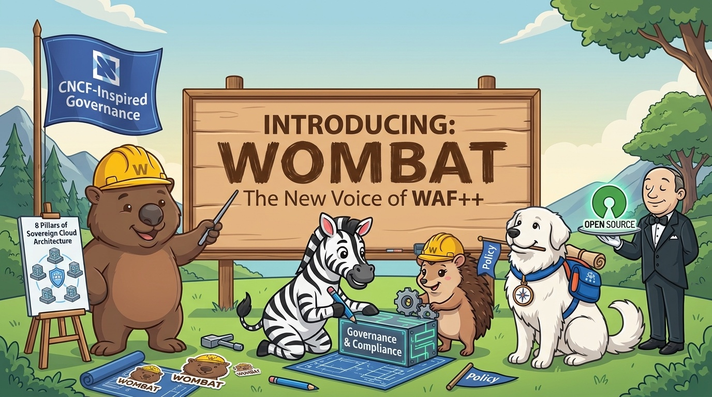
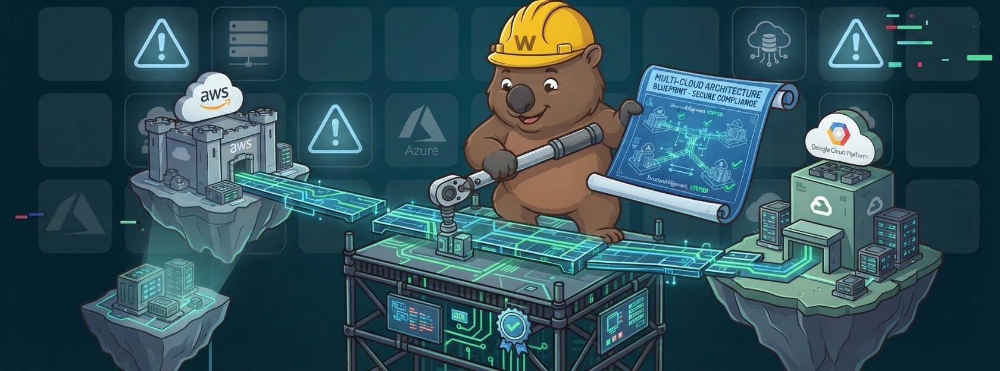
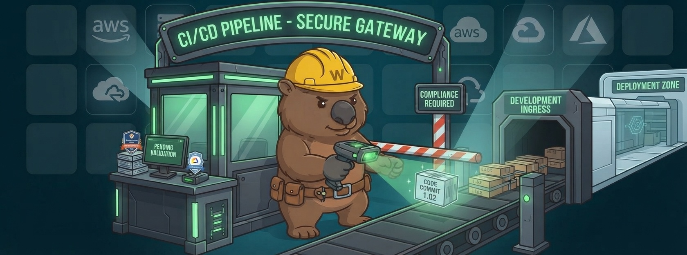
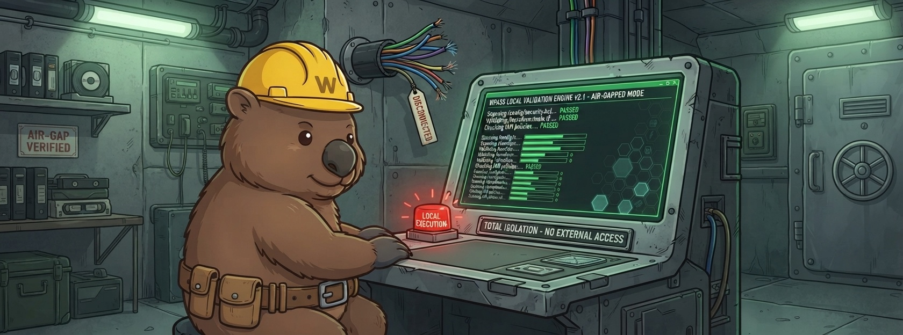
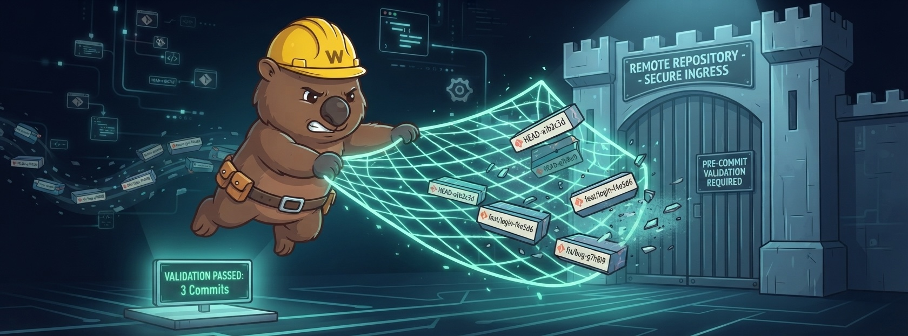
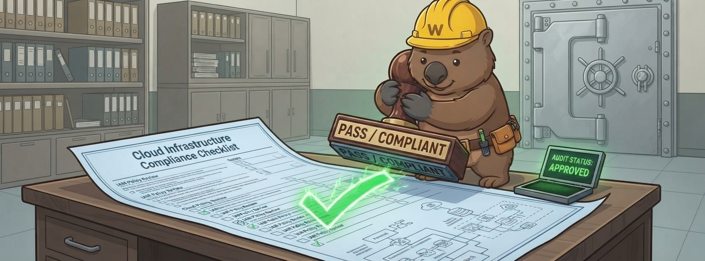
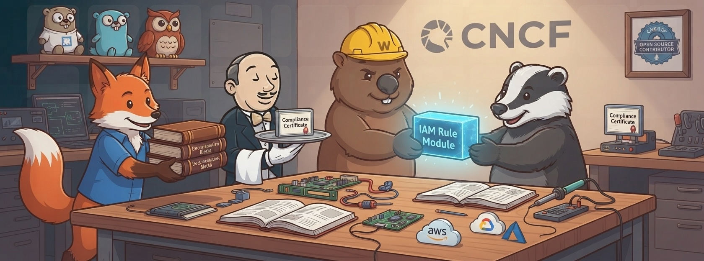

On 28 October 2026, the project that started as WAF++ became Wombat.

This is not a pivot. Nothing was acquired, nothing was forked away, no strategy deck was involved. The controls, the code, the licenses, the governance model and the people are the same people who were arguing about cloud architecture in a hotel bar eleven months earlier.

What changed is the thing the community has to say out loud a hundred times a day: its name.

## Where this started

It was the evening before Cloud Native Conference 2025. Tim, Sebastian and I were sitting in a hotel bar with too little power and too much to talk about — cloud architecture, sovereignty, provider lock-in, and the uncomfortable realization that the "best practices" we were all supposed to follow were mostly someone's product roadmap with a diagram on top.

The gap was obvious: every hyperscaler has a Well-Architected Framework. None of them is neutral. None of them is owned by the people who actually build the architectures. There was no open, engineering-first, community-driven counterpart.

Two weeks later Artem joined, and — fittingly — he was also the one who came up with the first name.

Our open-source idea was never "publish a PDF and hope people cite it". It was that the criteria themselves must be public, citable, forkable and contestable. Every control should be something you can point at in an audit, disagree with in a pull request, and improve in public.

## What we actually built

A lot has happened between that bar and this post:

- **February 2026** — the marketing site and the Antora documentation went live.
- **12 May 2026** — version 1.0 of the framework and of the tooling shipped, one day before Cloud Native Conference 2026 in Frankfurt.
- **July 2026** — the Agentic pillar landed, taking the framework to eight pillars.
- **Today** — framework v1.1, WOMBATpass v1.1.0, more than 100 controls, the PASS scoring model, and governance through public RFCs.

The tooling grew with it. WOMBATpass is a CLI, a dashboard and a server, plus a GitHub Action and an MCP server. It parses Terraform and AWS CDK statically, evaluates the controls, and produces auditor-ready evidence — without needing cloud credentials.

<figure class="article-fig">
  
  <figcaption>One blueprint across isolated provider estates — that is the whole idea in one picture. The blueprint is public, and anyone can change it.</figcaption>
</figure>

## The part of open source we got wrong

Here is the uncomfortable bit: our licenses were open from day one. Apache 2.0 for the code, CC BY 4.0 for the documentation. Our governance was open, too — every significant decision goes through a public RFC, with the reasoning attached.

And still, something was broken.

Because openness is not only a `LICENSE` file. It is also whether people can find you, say your name, and cite you without a footnote. And "WAF++" failed all three:

- In security conversations, **WAF already means Web Application Firewall**. Every single introduction started with a correction.
- The **"++" does not survive** search engines, URLs, or a conference hallway. It is a programming reference that most of our audience never signed up for.
- In the wild, the project appeared as **WAF++, WAF2p, waf2p and WAFpass** — sometimes within the same sentence.

A community cannot own a name it has to explain first. So we treated the name like any other defect: we fixed it.

> Open source is not a license you attach. It is a name people can carry.

<figure class="article-fig">
  
  <figcaption>Compliance as a gate in the pipeline, not a slide deck after the project. Same control, new voice.</figcaption>
</figure>

## Why a wombat?

Because it is a builder. It digs tunnels, maintains them, and connects things that would otherwise stay apart — and it does that underground, without needing applause. That is a fairly accurate description of architecture work and of a community project.

It is also practical: an animal is pronounceable in every language, findable in every search engine, and impossible to confuse with a firewall.

Wombat is not a second project next to WAF++. It *is* WAF++ — with a name that works. The announcement image says it better than I can: the new voice of WAF++.

## What changes — the short version

- **Project and framework:** WAF++ → **Wombat**
- **Tooling:** WAFpass → **WOMBATpass** (CLI, dashboard, server, GitHub Action, MCP server)
- **Command:** `wombat`
- **Website:** [www.wombat-gov.dev](https://www.wombat-gov.dev/)
- **Installers:** [wombat-cli.dev](https://wombat-cli.dev/)

Two identifiers are migrating as well, rather than being frozen. The Antora documentation gets renamed along with the framework — with fallback routing, so existing links under `/docs/wafpp/1.1.0/` keep resolving instead of breaking. And the two Python packages are being re-uploaded to PyPI under the new name. Until that migration lands, the current paths and packages keep working exactly as before.

<figure class="article-fig">
  
  <figcaption>Local execution, no external access. Static analysis stays inside your environment.</figcaption>
</figure>

## What does not change

The things that matter, and that no rename can touch:

- **Governance.** RFC-driven, public, with reasoning attached. No silent updates, no vendor deciding behind closed doors.
- **Licenses.** Code under Apache 2.0, documentation under CC BY 4.0.
- **Neutrality.** No hyperscaler, no single company, no upsell.
- **The substance.** Eight pillars, 100+ controls, the PASS scoring model, the evidence trail.
- **The people.** The same team, now with more contributors than we can keep track of — which is exactly the point.

And the history is not rewritten. Older articles on this blog keep the name "WAF++", because that is what the project was called when they were written. Removing that would be revisionism, not a rebrand.

<figure class="article-fig">
  
  <figcaption>Validation before ingest: three commits pass, the rest never reach the repository.</figcaption>
</figure>

## Where we go from here

The name was the last thing that still required an explanation. Everything else is in place: an open framework, working tooling, public governance, and a release cadence that we can keep.

What comes next is less glamorous and more important: more controls, more working groups, more real architectures reviewed in public, and more people who can say the project's name without adding a clause.

So — try it, break it, argue with it:

```bash
curl -fsSL https://wombat-cli.dev/install.sh | sh
pip install wafpass-core
```

The framework lives at [www.wombat-gov.dev](https://www.wombat-gov.dev/), the source on [GitHub](https://github.com/waf2p), and every decision starts as an RFC that anyone can open.

<figure class="article-fig">
  
  <figcaption>Audit status: approved. Not because a vendor said so — because the evidence is public and the criteria are citable.</figcaption>
</figure>

<figure class="article-fig">
  
  <figcaption>A framework is something people hand to each other. That is the open-source idea — now with a name that fits it.</figcaption>
</figure>

WAF++ was never a bad idea. It was a good idea with a name that kept getting in the way.

Welcome to the burrow.
